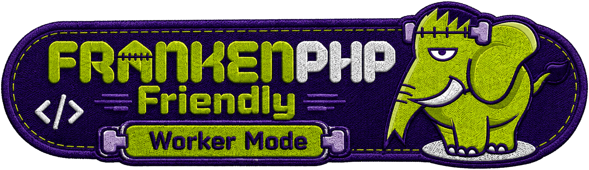
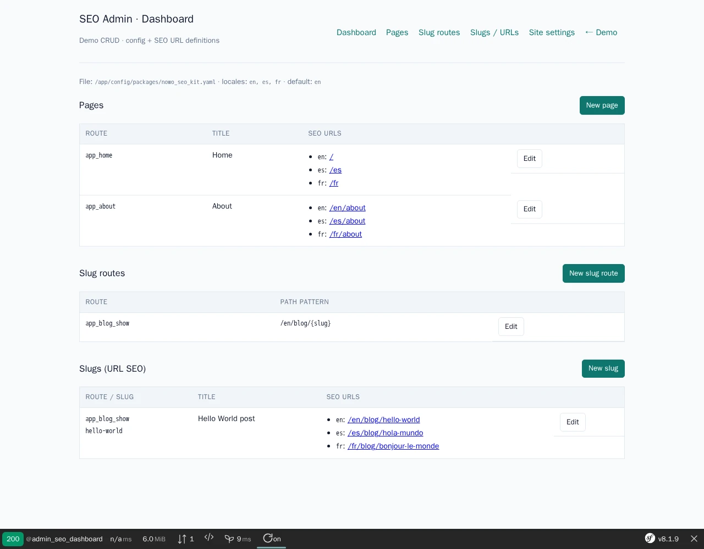

# Seo Kit Bundle

[](https://github.com/nowo-tech/SeoKitBundle/actions/workflows/ci.yml) [](https://packagist.org/packages/nowo-tech/seo-kit-bundle) [](https://packagist.org/packages/nowo-tech/seo-kit-bundle) [](LICENSE) [](https://php.net) [](https://symfony.com) [](https://github.com/nowo-tech/SeoKitBundle) [](#tests-and-coverage)

> ⭐ **Found this useful?** Give it a star on GitHub! It helps us maintain and improve the project.

Symfony SEO kit: multilingual static routes, slug SEO layers (defaults / pages / slug patterns / specific slugs), head tags, hreflang, sitemap and robots for FrankenPHP, php-fpm and Nginx.



This bundle is **FrankenPHP worker mode friendly**.



## Table of contents

- [Features](#features)
- [Installation](#installation)
- [Requirements](#requirements)
- [Version information](#version-information)
- [Demos](#demos)
- [Documentation](#documentation)
  - [Additional documentation](#additional-documentation)
- [Tests and coverage](#tests-and-coverage)
- [License](#license)

## Features

- ✅ **Hierarchical SEO config** — defaults → slug_routes → pages → slugs → attribute → runtime
- ✅ **Twig head helper** — `{{ nowo_seo_head() }}` with Open Graph, Twitter, JSON-LD, canonical, hreflang
- ✅ **Multilingual paths** — locale-specific paths and translated slugs
- ✅ **X-Robots-Tag** — opt-in `x_robots_tag.enabled`: the page's robots value as a response header (HTML, JSON, files)
- ✅ **Sitemap & robots** — `/sitemap.xml` and `/robots.txt` served by Symfony; extra User-agent groups via `robots.groups` or `GeoRobotsGroupsProviderInterface` (GEO crawler policy: [GenerativeSeoKitBundle](https://github.com/nowo-tech/GenerativeSeoKitBundle))
- ✅ **Typed JSON-LD** — Organization, LocalBusiness, Person, FAQPage, BlogPosting and related nodes
- ✅ **Runtime overrides** — `SeoRuntime` for dynamic titles from controllers
- ✅ **Host providers** — defaults, indexability, sitemap URLs, and extra robots groups
- ✅ **Optional Doctrine site settings** — `persistence.enabled` + `SeoSiteConfig` snapshot
- ✅ **Audit CLI** — `nowo:seo:audit` with tagged subject providers
- ✅ **Optional SEO admin + pencil API** — site settings, surface overrides, FormKit forms, `OriginUrlGuard`
- ✅ **Surface helpers** — `SeoSurfaceKeys` + `SeoSurfaceManager` for CMS/blog pencils
- ✅ **AbsoluteUrlBuilder** — origin + path normalisation from `base_url`
- ✅ **PHP 8 attribute** — `#[Seo]` on controllers
- ✅ **FrankenPHP-ready demo** — single-container Symfony 8 demo

**FrankenPHP:** Demos use a **single PHP service** (FrankenPHP, no nginx). With **`APP_ENV=dev`** (default), the Docker **entrypoint swaps in `Caddyfile.dev`** — **`php_server` without workers** for comfortable local development. The baked-in production `Caddyfile` can use **`php_server { worker … }`**; see [docs/DEMO-FRANKENPHP.md](docs/DEMO-FRANKENPHP.md). Access the demo at `http://localhost:PORT` (see `demo/README.md` and `.env.example`).

## Installation

```bash
composer require nowo-tech/seo-kit-bundle
```

Register the bundle in `config/bundles.php` (Flex does this automatically):

```php
Nowo\SeoKitBundle\SeoKitBundle::class => ['all' => true],
```

Add to your base layout:

```twig
{{ nowo_seo_head() }}
```

## Requirements

- PHP >= 8.2, < 8.6
- Symfony **7.4+** or **8.x**
- `nowo-tech/form-kit-bundle` ^2.4 (hard dependency)

GEO (Generative Engine Optimization — **not** geolocation) is a companion package: [`nowo-tech/generative-seo-kit-bundle`](https://packagist.org/packages/nowo-tech/generative-seo-kit-bundle) (`llms.txt`, AI crawler robots groups via this bundle’s SPI, citation index, `nowo:generative-seo:audit`). This kit stays classical SEO (head, sitemap, canonical, hreflang).

## Version information

| Version | PHP | Symfony | Status |
|---------|-----|---------|--------|
| 1.12.x | >= 8.2 | 7.4 – 8.1+ | Stable |
| 1.11.x | >= 8.2 | 7.4 – 8.1+ | Stable |
| 1.10.x | >= 8.2 | 7.4 – 8.1+ | Stable |
| 1.9.x | >= 8.2 | 7.4 – 8.1+ | Stable |
| 1.8.x | >= 8.2 | 7.0 – 8.1+ | Stable |
| 1.7.x | >= 8.2 | 7.0 – 8.1+ | Stable |
| 1.6.x | >= 8.2 | 7.0 – 8.1+ | Stable |
| 1.5.x | >= 8.2 | 7.0 – 8.1+ | Stable |
| 1.4.x | >= 8.2 | 7.0 – 8.1+ | Stable |
| 1.3.x | >= 8.2 | 7.0 – 8.1+ | Stable |
| 1.2.x | >= 8.2 | 7.0 – 8.1+ | Stable |
| 1.1.x | >= 8.2 | 7.0 – 8.1+ | Stable |
| 1.0.x | >= 8.2 | 7.0 – 8.1+ | Stable |

## Demos

```bash
make -C demo up-symfony8   # http://localhost:8050 (default PORT)
```

Demo extras: locale switch, `/` default-locale home, SEO Admin at `/admin/seo`. See [docs/DEMO-FRANKENPHP.md](docs/DEMO-FRANKENPHP.md).

The screenshot at the top is the demo SEO Admin. Refresh it with `make -C demo/symfony8 demo-screenshots`; `make -C demo/symfony8 test-e2e` runs the Playwright happy path (localized metadata, hreflang switch, sitemap/robots, admin).

## Documentation

- [Installation](docs/INSTALLATION.md)
- [Configuration](docs/CONFIGURATION.md)
- [Usage](docs/USAGE.md)
- [Contributing](docs/CONTRIBUTING.md)
- [Code of Conduct](CODE_OF_CONDUCT.md)
- [Changelog](docs/CHANGELOG.md)
- [Upgrading](docs/UPGRADING.md)
- [Release](docs/RELEASE.md)
- [Security](docs/SECURITY.md)
- [Engram](docs/ENGRAM.md)
- [Spec-driven development](docs/SPEC-DRIVEN-DEVELOPMENT.md)
- [GitHub Spec Kit](docs/SPEC-KIT.md)

### Additional documentation

- [PSR evaluation (REQ-CS-007)](docs/PSR.md)
- [Demo with FrankenPHP](docs/DEMO-FRANKENPHP.md) (includes worker mode)
- [FrankenPHP worker audit](docs/FRANKENPHP-WORKER-AUDIT.md) (kernel not reset between requests)
- [Server cookbook (Nginx, php-fpm, FrankenPHP)](docs/SERVERS.md)
- [GitHub Actions CI requirements](docs/GITHUB_CI.md)

## Tests and coverage

```bash
make test
make test-coverage
```

- Tests: PHPUnit (`tests/Unit` + kernel integration in `tests/Integration`)
- PHP: **100%** lines (2520/2520, `make test-coverage`). TS/JS: N/A. Python: N/A.

## License

MIT — see [LICENSE](LICENSE).
